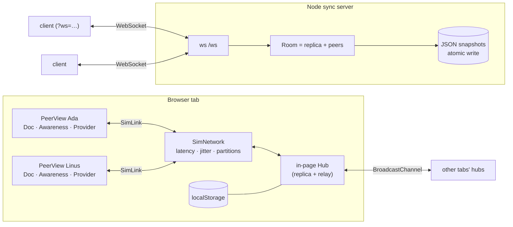
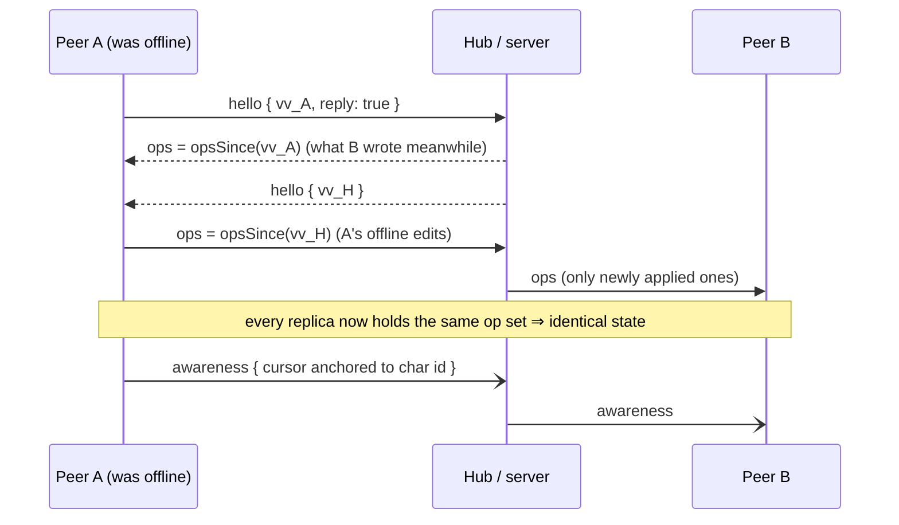

# crdt-collab

[](https://github.com/HOFFMAN-ALTERNATIVE/crdt-collab/actions/workflows/ci.yml)


[](LICENSE)

**Realtime collaborative text + whiteboard on a CRDT written from scratch** — no
Yjs, no Automerge. An RGA sequence CRDT for text, LWW registers for the
whiteboard, Lamport clocks, version-vector delta sync, causal buffering,
presence (live carets and pointers), offline editing with conflict-free merge,
a hardened WebSocket sync server, and a dark HUD front-end.

### ▶ [Live demo](https://hoffman-alternative.github.io/crdt-collab/)

The demo runs several simulated peers side by side in one page over a
simulated network you can sabotage: add latency, enable jitter (packets arrive
out of order), cut peers off, let a chaos monkey type and flap links — then
watch every replica converge to the same fingerprint. Open it in a second tab
and the tabs sync too (BroadcastChannel).

## Why

"Google-Docs-style" collaboration is usually treated as magic you import.
This project implements the core ideas directly, small enough to read in one
sitting and tested hard enough to trust:

- **Strong eventual consistency** — replicas that have seen the same set of
  operations are identical, regardless of order, duplication or delay. Proven
  with property-based tests over thousands of random multi-replica histories.
- **Offline-first** — edits made while disconnected are just ops in the local
  log; reconnecting exchanges version vectors and ships exactly the missing
  ops in both directions.
- **Intention preservation** — concurrent runs of text typed at the same spot
  never interleave character-by-character; a deleted character still anchors
  later inserts and remote carets.

## Features

| Area | What's inside |
|---|---|
| Text CRDT | RGA (Replicated Growable Array) with Lamport ids, tombstones, run inserts (one op per typed string, one node per UTF-16 unit), stable caret anchors (`caretAfter(id)`) |
| Map CRDT | LWW map; whiteboard shapes are stored **per field** (`shape/<id>/<field>`) so a concurrent move and recolour both survive; delete is its own register, so delete beats a concurrent move |
| Replication | Per-client `seq` + version vectors, `opsSince(vv)` delta sync, causal buffer for ops that arrive before their dependencies, duplicate suppression, state fingerprint |
| Presence | Awareness protocol with per-client clocks, heartbeats and expiry; remote carets anchored to character ids, remote pointers and selections on the board |
| Sync server | Node `ws`, rooms, server-side replica (it merges, never transforms), validation of every message, 1 MiB frames, per-connection token-bucket rate limit, ping/pong liveness, origin allow-list, atomic JSON snapshots per room, `/healthz`, `/api/rooms` |
| Front-end | Vite + vanilla TypeScript, dark HUD style, textarea editor with mirror-rendered remote carets, SVG whiteboard (rect, ellipse, sticky note, pen), simulated network with latency/jitter/partitions, chaos monkey, multi-tab via BroadcastChannel, localStorage persistence |
| Quality | strict TS, ESLint, Vitest + fast-check (1000 runs/property in CI), Playwright browser e2e, Docker image smoke test, GitHub Pages deploy |

## Architecture



The same symmetric protocol (`hello` / `ops` / `awareness`) runs over every
transport: in-memory links, BroadcastChannel and WebSocket. A hub is just
another replica that relays the ops it has not seen before, so it never needs
to understand edits — no operational transformation on the server.

### Sync handshake (incl. offline merge)



### How the RGA decides where a character goes

Every character is inserted *after* a reference character and gets a Lamport
id `(clock, client)` greater than anything its author has seen. To integrate
an insert, start right after the reference and **skip every node whose id is
greater than the new one**. Because descendants always carry larger ids than
their ancestors, this skips entire subtrees of newer concurrent inserts and
stops at the same slot on every replica — whatever the arrival order. Deletes
only flip a tombstone flag, so later inserts can still reference the
character. See [`src/crdt/rga.ts`](src/crdt/rga.ts).

## Quick start

```bash
npm ci
npm run dev                 # front-end on http://localhost:5173 (simulated peers)

# real network: sync server + front-end served together
npm run build && npm start  # http://localhost:8787
# open http://localhost:8787/?ws=ws://localhost:8787/ws&room=team in several browsers

docker build -t crdt-collab . && docker run -p 8787:8787 -v crdt-data:/data crdt-collab
```

| URL parameter | Effect |
|---|---|
| `room=<name>` | room to join (`[A-Za-z0-9_-]{1,64}`) |
| `ws=<url>` | use the WebSocket server instead of the simulated network |

Server env: `PORT` (8787), `HOST`, `DATA_DIR` (`data`), `STATIC_DIR`, `ALLOWED_ORIGINS` (comma-separated).

## Project layout

```
src/crdt/      id · rga · lww · doc · awareness · whiteboard   (pure, no deps, no DOM)
src/sync/      protocol (validation) · hub (rooms) · provider (client binding)
src/server/    WebSocket server · file store · entrypoint
web/           Vite front-end: peer view, transports (sim, ws, tabs), HUD styles
test/          Vitest unit + fast-check property tests + server integration
e2e/           Playwright browser tests (sim, multi-tab, WebSocket)
```

## Design decisions & trade-offs

- **RGA over OT.** Operational transformation needs a central server to order
  and transform operations; a CRDT lets any replica merge anything, which is
  what makes offline editing, multi-tab mesh and a "dumb" relay server work.
  The cost is metadata: every character carries an id and deleted characters
  remain as tombstones.
- **Flat array + index instead of a tree.** Integration is O(n) per character,
  fine for documents of tens of thousands of characters and easy to verify.
  Yjs/Automerge-scale performance needs run-length-encoded items and a B-tree
  or skip list — a contained change behind the same `Rga` API.
- **No tombstone GC.** Safe garbage collection requires knowing that every
  replica has seen a delete (causal stability); with offline peers that is
  unknowable without membership tracking. The op log can be compacted into a
  snapshot when a deployment can bound its replica set.
- **Version vectors over per-client seq, Lamport clocks for ordering.** `seq`
  is contiguous per client (cheap "what am I missing?"), Lamport clocks are
  global (a total order for RGA siblings and LWW). Using one for both breaks
  either delta sync or ordering.
- **Causal buffering in the replica, not the transport.** Ops whose reference
  character hasn't arrived wait in a bounded buffer; that is why the demo can
  add jitter that reorders packets and still converge. TCP ordering is a bonus,
  not a requirement.
- **Field-level LWW for shapes.** Whole-object LWW would drop one of two
  concurrent edits; per-field registers keep both unless they touch the same
  field. Delete is a separate register so "delete wins" is deterministic.
- **JSON wire format.** Easy to debug and validate; a binary encoding with
  run-length ids would cut bandwidth ~5–10× and is the next step at scale.
- **Server keeps a replica.** Late joiners and offline peers catch up even when
  nobody else is online, and the server can persist rooms; it still never
  interprets edits beyond merging.

## Testing

```bash
npm test          # unit + property + server integration (Vitest)
npm run e2e       # Playwright: simulated peers, chaos monkey, multi-tab, WebSocket mode
npm run check     # lint + typecheck + tests + build
FC_RUNS=5000 npm test   # crank up the property tests
```

Property-based tests ([`test/convergence.property.test.ts`](test/convergence.property.test.ts)) generate
random histories for 2–4 replicas — inserts, deletes, map writes and shape
edits interleaved with partial, duplicated and out-of-order deliveries — and
assert:

1. **Convergence:** after draining the network in a random order, all replicas
   have identical text, map, shapes and fingerprint, with nothing left buffered.
2. **Commutativity & idempotence:** a fresh replica fed the full op set in a
   random permutation (and then again, reversed) reaches the same state.
3. **Model equivalence:** a single replica behaves exactly like a plain string
   under random edits.
4. **Intention preservation:** two concurrent runs typed at the same index stay
   contiguous.

A mutation check is part of the development loop: breaking the RGA skip rule
makes fast-check produce a minimal counterexample within a handful of runs.

Server integration tests run real WebSocket clients: three-way concurrent +
offline merge, room isolation, presence relay, persistence across restarts,
and rejection of malformed messages, missing handshakes and floods.

## License

[MIT](LICENSE) © Herman Hoffman
